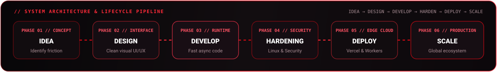

<div align="center">

<a href="https://shahriyarsojibhasan.top/">
  
</a>


<br/>

<p align="center">
  <a href="https://shahriyarsojibhasan.top/">
    
  </a>
  &nbsp;
  <a href="mailto:hello@shahriyarsojibhasan.top">
    
  </a>
  &nbsp;
  <a href="https://t.me/shahriyarsojibhasan">
    
  </a>
</p>

<p align="center">
  
  &nbsp;
  
  &nbsp;
  
</p>

<br/><br/>


</div>

# // ABOUT ME

<table>
<tr>
<td width="55%" valign="middle">

### 👤 Shahriyar Sojib Hasan
**Full-Stack Developer · Mobile Apps · Systems & Linux**

```yaml
name: Shahriyar Sojib Hasan
location: Bogura, Bangladesh 🇧🇩
building_since: 2020
birthday: 29 May

focus:
  - Web Applications & Android Mobile Apps
  - Linux (Kali) & Network Security
  - Hardware Diagnostics & Electronics

loves:
  - Coffee, Tea & Road Trips ☕🌍
  - Night Coding & Cyber Aesthetics 🌙

dream:
  Travel the world while coding 🌍
```

</td>
<td width="45%" align="center" valign="middle">

<a href="https://shahriyarsojibhasan.top/">
  
</a>

</td>
</tr>
</table>

<div align="center">
  
</div>

# // FEATURED CREATIONS

<div align="center">

<table>
<tr>
<td width="50%" align="center" valign="top">
  <a href="https://github.com/shahriyarsojibhasan/RESULTSNIPER-BD">
    
  </a>
  <br/>
  <a href="https://resultsniper-bd.vercel.app"><code>resultsniper-bd.vercel.app ↗</code></a> · <code>Python · aiohttp · HMAC-SHA256</code>
</td>
<td width="50%" align="center" valign="top">
  <a href="https://github.com/shahriyarsojibhasan/DUOVISTA-PDF-VIEWER">
    
  </a>
  <br/>
  <a href="https://shahriyarsojibhasan.top/DUOVISTA-PDF-VIEWER/"><code>Live Split PDF Studio ↗</code></a> · <code>MV3 Extension · PDF.js · PWA</code>
</td>
</tr>
<tr>
<td width="50%" align="center" valign="top">
  <a href="https://github.com/shahriyarsojibhasan/WIFI-CHARGER-CONTROLLER">
    
  </a>
  <br/>
  <code>NodeMCU ESP8266 · Flutter Web · Kotlin APK · Firebase RTDB</code>
</td>
<td width="50%" align="center" valign="top">
  <a href="https://github.com/shahriyarsojibhasan/SHAHRIYAR-LIVE-TV">
    
  </a>
  <br/>
  <a href="https://stv.shahriyarsojibhasan.workers.dev/"><code>Workers Player ↗</code></a> · <a href="https://shahriyarsojibhasan.top/SHAHRIYAR-LIVE-TV/"><code>Pages ↗</code></a> · <code>Python · CI</code>
</td>
</tr>
<tr>
<td width="50%" align="center" valign="top">
  <a href="https://github.com/shahriyarsojibhasan/FRB-RELEASE-APK">
    
  </a>
  <br/>
  <code>React · Capacitor · Cloudflare R2 · Signed APK v2.5.4</code>
</td>
<td width="50%" align="center" valign="top">
  <a href="https://github.com/shahriyarsojibhasan/SHAHRIYAR-TOOLS">
    
  </a>
  <br/>
  <a href="https://shahriyarsojibhasan.top/SHAHRIYAR-TOOLS/"><code>Live Web Studio ↗</code></a> · <code>Poster &amp; Passbook Tools</code>
</td>
</tr>
</table>

<details>
<summary><strong>View Complete Public Repository Directory (All 12 Repositories) ↗</strong></summary>

<br/>

| Repository | Domain | Tech Stack | Live / Release |
| :--- | :--- | :--- | :--- |
| [**RESULTSNIPER-BD**](https://github.com/shahriyarsojibhasan/RESULTSNIPER-BD) | EdTech · Analytics | `Python` · `aiohttp` · `HMAC-SHA256` | [resultsniper-bd.vercel.app](https://resultsniper-bd.vercel.app) |
| [**DUOVISTA-PDF-VIEWER**](https://github.com/shahriyarsojibhasan/DUOVISTA-PDF-VIEWER) | Academic · Extension/PWA | `JavaScript` · `PDF.js` · `MV3` | [Live Studio](https://shahriyarsojibhasan.top/DUOVISTA-PDF-VIEWER/) |
| [**WIFI-CHARGER-CONTROLLER**](https://github.com/shahriyarsojibhasan/WIFI-CHARGER-CONTROLLER) | IoT · Embedded & Mobile | `ESP8266` · `Flutter` · `Kotlin` · `Firebase` | `v6.2.5 APK & Firmware` |
| [**SHAHRIYAR-LIVE-TV**](https://github.com/shahriyarsojibhasan/SHAHRIYAR-LIVE-TV) | Edge · Streaming CI | `Python` · `Cloudflare Workers` · `Actions` | [Workers](https://stv.shahriyarsojibhasan.workers.dev/) · [Pages](https://shahriyarsojibhasan.top/SHAHRIYAR-LIVE-TV/) |
| [**FRB-RELEASE-APK**](https://github.com/shahriyarsojibhasan/FRB-RELEASE-APK) | EdTech · Android LMS | `React` · `Capacitor` · `Cloudflare R2` | `Signed APK v2.5.4` |
| [**SHAHRIYAR-TOOLS**](https://github.com/shahriyarsojibhasan/SHAHRIYAR-TOOLS) | Web Utility Studio | `HTML5` · `CSS3` · `html2canvas` | [Live Studio](https://shahriyarsojibhasan.top/SHAHRIYAR-TOOLS/) |
| [**FACEBOOK-BOT**](https://github.com/shahriyarsojibhasan/FACEBOOK-BOT) | Automation · Bot Engine | `JavaScript` · `Node.js` | `Modular Plugin Suite` |
| [**SHAHRIYAR-WIFI-CRACK**](https://github.com/shahriyarsojibhasan/SHAHRIYAR-WIFI-CRACK) | Network Security CLI | `Python` · `Linux` · `WPS / Pixiewps` | `CLI + GUI Launcher` |
| [**SHAHRIYAR-BOMB**](https://github.com/shahriyarsojibhasan/SHAHRIYAR-BOMB) | Python CLI Tooling | `Python` · `Requests` | `Terminal Utility` |
| [**001**](https://github.com/shahriyarsojibhasan/001) | Express Process Loader | `JavaScript` · `Node.js` · `Express` | `Runtime Supervisor` |
| [**shahriyarsojibhasan.github.io**](https://github.com/shahriyarsojibhasan/shahriyarsojibhasan.github.io) | Production Web Portfolio | `TypeScript` · `React` · `WebGL` · `Vite` | [shahriyarsojibhasan.top](https://shahriyarsojibhasan.top/) |
| [**shahriyarsojibhasan**](https://github.com/shahriyarsojibhasan/shahriyarsojibhasan) | GitHub Profile Readme | `Markdown` · `Custom Animated SVGs` | [GitHub Profile](https://github.com/shahriyarsojibhasan) |

</details>

</div>

<div align="center">
  
</div>

# // TECH STACK

<div align="center">


</div>

<div align="center">
  
</div>

# // DIGITAL WORKSPACE

<div align="center">

<table>
<tr>

<td align="center" width="25%">

### SYSTEM


```bash
Windows 11 Pro
Kali Linux
WSL2 Ubuntu
```

</td>

<td align="center" width="25%">

### TERMINAL


```bash
Windows Terminal
PowerShell 7
ZSH + Oh My Zsh
Bash
```

</td>

<td align="center" width="25%">

### EDITORS & IDEs


```bash
VS Code
Android Studio
Arduino IDE / Neovim
```

</td>

<td align="center" width="25%">

### WORKFLOW


```bash
Modern Web & Mobile
Network Security Audits
IoT Hardware Diagnostics
Deep Night Coding Flow
```

</td>

</tr>
</table>

</div>

<div align="center">
  
</div>

# // GITHUB ANALYTICS

<div align="center">


<br/><br/>


<br/><br/>


</div>

<div align="center">
  
</div>

# // CONTRIBUTION TIMELINE

<div align="center">


</div>

<div align="center">
  
</div>

# // SYSTEM PIPELINE

<div align="center">



</div>

<div align="center">
  
</div>

# // TERMINAL.LOG

<div align="center">



</div>

<div align="center">
  
</div>

# // ENGINEERING PHILOSOPHY

<div align="center">

> *Build resilient systems that feel alive.*  
> *Design intuitive experiences that people remember.*

<br/>

> **Minimal aesthetics. Maximum performance. Zero paywalls.**

</div>

---

# // CONNECT WITH ME

<div align="center">

<a href="https://shahriyarsojibhasan.top/">
  
</a>
&nbsp;
<a href="mailto:hello@shahriyarsojibhasan.top">
  
</a>
&nbsp;
<a href="https://github.com/shahriyarsojibhasan">
  
</a>
&nbsp;
<a href="https://linkedin.com/in/shahriyarsojibhasan">
  
</a>
&nbsp;
<a href="https://x.com/shahriyarsojib_">
  
</a>
&nbsp;
<a href="https://t.me/shahriyarsojibhasan">
  
</a>
&nbsp;
<a href="https://youtube.com/@shahriyarsojibhasan">
  
</a>
&nbsp;
<a href="https://instagram.com/shahriyarsojibhasan">
  
</a>
&nbsp;
<a href="https://facebook.com/shahriyarsojibhasan">
  
</a>
&nbsp;
<a href="https://buymeacoffee.com/shahriyarsojibhasan">
  
</a>

</div>

---

# // CORE MINDSET

<div align="center">

```text
Code. Create. Harden. Repeat.
```

</div>

---

<div align="center">


### SHAHRIYAR SOJIB HASAN

Full-Stack Developer • Mobile Apps • Systems & Cybersecurity • Dreaming beyond borders

</div>
